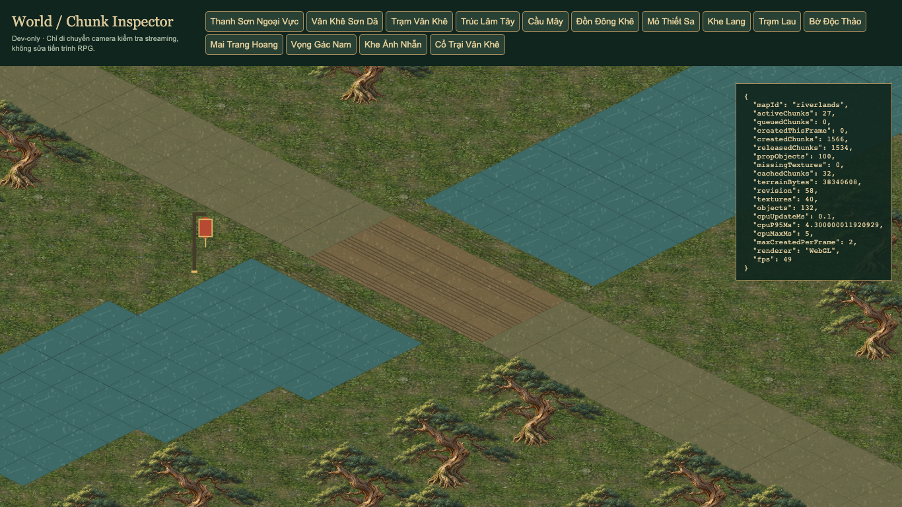

# Kiếm Hiệp Web · Giang Hồ Ký

Bản phát triển **v0.6.0-dev — Thanh Vân Sơn & nội dung mới** tiếp tục shared TypeScript simulation, Phaser3.90 và React của repository hiện tại. Mục tiêu vẫn là Full Offline RPG trong [yêu cầu Full Offline RPG](docs/FULL_OFFLINE_RPG.md); **chưa phải bản game hoàn chỉnh hoặc production art**.



## Chạy game

Node22.12+ và pnpm10.34.5; đã kiểm tra với Node22.22.

```sh
pnpm install
pnpm dev
```

Mở [localhost:5173](http://localhost:5173). Game không còn header/footer website; nút nổi góc phải mở menu/settings/lưu/minimap. Quest tracker thu gọn được, minimap có chế độ mở rộng, thông báo autosave tự ẩn. PC có hotbar nổi; mobile có joystick,4chiêu,đánh thường,thuốcHP/MP,auto và khóa mục tiêu. Giữ joystick rồi dùng ngón khác bấm chiêu được kiểm tra qua touch events.

Lần đầu mở game phải tạo nhân vật; lần sau mở màn hình chọn nhân vật. Có5slot cho cả tạo mới và import, tên tiếngViệt chuẩn hóa/chốngtrùng, xem trước actor8hướng, trang bị/map/playtime và xóa cóarchive. Chỉ sau khi chọn mới chạy thế giới.

Đường chơi đầu: gặp trưởng thôn → đánh sơn tặc → rừng trúc → lang vương → Hắc Phong Trại/boss. Bấm môn phái cạnh tên để tạo/chọn nhân vật; Võ học có2nhánh/phái và gán4ô. Cường hóa/ngọc/craft/kho làm thay đổi state thật, yêu cầu gần đúngNPC; mở từ Hành trang/menu.

**Đồ rơi thật:** đánh quái nhậnEXP, bạc/item nằm dướiđất; bấm tên hoặc nútNhặt gần nhân vật. Đồ có chủ sở hữu,10phút game tồn tại, túi đầy giữ đồ lại. MenuNghềnghiệp cóauto pickup/lọcphẩmchất/dừngkhiđầy; vùngfarmneoởchỗbậttựchiến. Joystick dùnghướngđiềukhiểnfixedtick với deadzone/TTL, khôngchạynạplạiA*liêntục.

**Vùng luyện cấp lớn 320×320 (mới):** mở bản đồ(M) ở Vân Khê → cổng **Thanh Vân Sơn · Cấp 9–16** ngay gần Trúc Lâm Tây. Bãi quái sát sơn môn, 16 bãi theo cấp 9–16, hồ Vân + sông + 2 cầu đá, vách đá đông bắc, 15 địa danh (6 điểm khám phá, 1 khu boss Vân Đỉnh), 7 NPC tiền tiêu (thợ rèn/dược/thủ kho có dịch vụ), 9 nhiệm vụ theo chuỗi, 6 điểm tài nguyên và 10 loại quái mới gồm boss **Vân Sơn Yêu Vương**. Quái có `skillIds` thật sự thi triển kỹ năng; trang bị mới có 6 phẩm chất, yêu cầu cấp, ô mũ/phụ kiện và phụ từ ngẫu nhiên sinh bằng RNG authority.

**Vùng Thanh Sơn trước đây:** mở bản đồ (M), chọn cổng Thanh Sơn Ngoại Vực. Vùng128×128 có8địa danh, đường chính/nhánh, bãi quái/tài nguyên,2NPC và7quest. Trong nhật ký (J), tìm **Qua đèo Trúc Ảnh → Gặp Lục tuần sơn**, nhận quest rồi dùng Theo dõi mục tiêu. Khảo sát tiến triển khi nhân vật đi vào vùng, quay lại nhận thưởng; đây là hành trình mới đã chạy qua UI PC/mobile không grant tài nguyên.

## Thay đổi thực tế

- Terrain8×8/chunk, prop index/culling/prefetch/unload, tối đa2chunk/frame; actor/lootview ngoài viewport được hủy, dữ liệu gameplay giữ lại. Camera follow/dead zone/zoom bằng wheel, cảnh quan biên và reduced motion.
- 4prop PNG và1texture nền gốc (nhà/thông/mai/trúc), alpha/pivot/size manifest, validator và asset preview. Runtime khoảng1.63MiB; source lớn không nằm trong build/cache. Actor/NPC/terrain/UI vẫn còn art phát triển.
- VFX graphics/text có pool/budget, hình khác nhau theo5hệ, projectile head/impact/hit feedback.
- Audio mixer Master/Music/Ambient/Combat/UI, volume/mute/fade/crossfade/voicebudget, unlock/pause/dispose; nhạc/SFX tổng hợp gốc, chưa là thư viện thu âm production.
- Navigationchunk16/component/gateway +heapA*/LRU64/invalidation; AI active24/nearby48/inactive và spawnzones seeded/fixedtick.
- HeapA*/blocked index, area quest/maprestriction, quest navigation theo graph/NPC, hotbar đổi chỗ tránh trùng, cường hóa chốngdoubletap10ticks.
- QualityAuto/Low/Medium/High, joystickfixed/floating, reduced motion và audio volumes lưu ở client riêng, không sửa simulation/RPG state.

## Điều khiển

| Input               | Hành động                        |
| ------------------- | -------------------------------- |
| Chuột trái          | Đi/chọn quái/NPC/cổng/tài nguyên |
| Chuột phải lên quái | Chiêu đầu của loadout            |
| Wheel               | Camera zoom                      |
| WASD/mũi tên        | Di chuyển                        |
| Space/1             | Chọn mục tiêu gần và đánh thường |
| 2–5                 | Bốn chiêu đang gán               |
| Q/E                 | ĐanHP/MP                         |
| C/I/K/J/M           | Nhân vật/túi/võ học/quest/map    |
| Esc                 | Đóng panel                       |

Không kích movement hotkeys khi nhập text hoặc mở panel. Simulation vẫn chạy khi mở panel; pause ở Thiết lập dừng game clock. Client preferences riêng với character save; thay thiết bị sẽ không tự mang theo bố cục/âm lượng.

## Save và offline

```sh
pnpm build
pnpm preview --port 4173
```

Mở [localhost:4173](http://localhost:4173), đợi **Sẵn sàng offline**, rồi ngắt mạng/reload. ProductionPWA precache app và baseassetpack khoảng3.5MiB; terrain/atlas procedural dựng cục bộ. Dev không phải chứng minh offline. Điện thoại cầnHTTPS/localhost hoặc PWA; HTTPquaIPLAN không cho ServiceWorker như HTTPS.

SchemaSave vẫn **v2**, content **0.5.0**. Load/import v0.1, v0.2, v0.3 vàv0.4 có migration/archive nguyên nguồn, không xóa tiến trình. V0.2 giữ đồ nâng/ngọc/kho/nghề/quest/tick/RNG; map cũ không đổi geometry. Backup tốt không bị primary hỏng ghi đè. Một ô lưu lỗi có thể phục hồi đúng backup hoặc archive/xóa riêng mà không khóa các nhân vật khác. Có autosave15giây/đổimap/tabẩn, manualsave, import có xác nhận/exportJSON. Xuất save trước khi xóa dữ liệu site; assetcache khác characterdata. Migration phiên bản tương lai vẫn phải viết và test riêng.

Chưa có per-map asset-pack download/eviction UI; basepack hiện nhỏ được cache đầy đủ. Không bù EXP/loot từ wall clock khi tab bị throttle/đóng game.

## Phạm vi và backlog

| Nội dung                 |     Hiện có |                     Đích v1.0 |
| ------------------------ | ----------: | ----------------------------: |
| Phái/nhánh/kỹ năng       |   10/20/144 | đủ identity,balance,art/audio |
| Map playable             |           6 |                      khoảng50 |
| Monster/boss definitions |        16/2 |                      ≥100/≥20 |
| Items                    |          45 |                          ≥500 |
| Quests                   |          28 |                          ≥150 |
| Dungeon                  |           0 |                           ≥10 |
| Nghề/recipes/resources   |    7/11/22 |               progression sâu |
| Cấp                      | giới hạn100 |       nội dung/balance đến100 |

18staticspawns ở Thanh Sơn và16zones ở Thanh Vân Sơn; quái/elite placement không đếm thành definition mới. Chưa dungeon/companion/mount/guildNPC/arena/siege/achievements, setbonus/refinement/NPCmarket và tuyến truyện dài hạn. Chưa đạt production art, acoustic audio hoặc realdevice performance. [Trạng thái đối chiếu](docs/IMPLEMENTATION_STATUS.md) và [full-release backlog](docs/roadmap/full-release.md) giữ tất cả yêu cầu còn lại.

## Kiểm tra và công cụ

```sh
pnpm typecheck
pnpm lint
pnpm test
pnpm validate:content
pnpm validate:assets
pnpm report:content
pnpm build
pnpm exec playwright install chromium
pnpm test:e2e
```

Playwright tự mở/đóng preview4173 từ build hiện có. Báo cáo tại `playwright-report`; artifacts có ảnh/assetalpha/streaming/soak/balance. Xem [verification](docs/roadmap/verification.md) cho kết quả cuối và giới hạn bằng chứng. Các bài fixture không được tính là fullgame acceptance; có hành trình mới không grant qua UI trênPC/mobile.

Dev-only, không nằm trong productionbuild và không cấp debug API gameplay. `pnpm profile:core` đo navigation/simulation/clone trong Node; `pnpm profile:footprint` đo publish của world đã thăm tới 40map (map tổng hợp tái dùng monster definition thật, không phải content phát hành) tại `artifacts/world-footprint.json`. Khi dev server đang chạy, `pnpm profile:world` tái tạo báo cáo60visits/6mapchanges cho mỗi viewportPC/mobile tại `artifacts/streaming-browser.json`:

- [Asset browser/pivot](http://localhost:5173/asset-inspector.html)
- [Atlas8hướng/trạngthái](http://localhost:5173/animation-inspector.html)
- [World/chunk inspector](http://localhost:5173/world-inspector.html)

[Art source & prompt ImageGen](assets/source/overhaul/README.md), [rendering](docs/architecture/rendering.md), [worldstreaming](docs/architecture/world-streaming.md), [artbible](docs/design/art-bible.md), [audiobible](docs/design/audio-bible.md), [UI/UX](docs/design/ui-ux.md), [economy](docs/design/item-economy.md), [gameplaysystems](docs/design/gameplay-systems.md), [catalog](docs/CONTENT_CATALOG.md).

Core giữ Node khôngDOM,20Hz/seed,validatedcommands/event/snapshot/ownerRPG/replay. UI/renderer/audio không quyết định outcome. `LocalGameSession` publish view đã lọc theo bản đồ đang có người chơi (`viewSnapshot`) nên payload không tăng theo số bản đồ đã thăm; `getSnapshot()` vẫn trả authority đầy đủ cho lưu trữ. Dormant data, definition và navindex vẫn resident trong authority. Chưa triển khai server online; xem [online migration](docs/ONLINE_MIGRATION.md). Headless render smoke và4giờ simulation tăng tốc không thay thế benchmark điện thoại hoặc4giờ render/GPUmemory.

## Kiểm chứng v0.5

Typecheck/lint/build và content/asset validation đạt. **291 unit/integration +46 E2E Chromium đạt**; hai hành trình mới tạo nhân vật→đánh quái→đồ rơi→nhặt→save/reload quaUIkhônggrant.10phái đượckiểmtra từngcase độc lập. Có30phút shared-core farm khônggrant (375kills, cấp4→12), map256 offline/load PC/mobile và per-slot recovery; đây không phải30phút render trên thiết bị thật. View projection có bài integration riêng và một assertion browser kiểm payload publish nhỏ hơn tổng world. Cường hóa tới+15 có RNG authority, Đá Hộ Mệnh và log20dòng (8 case integration + assertion UI). Bản đồ Thanh Vân Sơn320×320 có10case integration và2case E2E đi cổng thật (quái mới được publish, save rồi offline reload). [Báo cáo và giới hạn](docs/roadmap/verification.md), [audit](docs/IMPLEMENTATION_STATUS.md), [roadmap hiện hành](docs/ROADMAP.md). Chưa chứng nhận artproduction/FPSđiệnthoạithật hoặc FullOfflineRPG.

### Visual overhaul review (19/10/2026)

UI/presentation mới và giới hạn production: [báo cáo](docs/visual/AFTER_REVIEW.md), [before/after gallery](artifacts/visual-review.html), [asset provenance/prompts](docs/visual/ASSET_PROVENANCE.md). Bộ chốt:295unit/integration,56browserE2E,WebKit smoke2viewport và113ảnh-checkpoint trên5viewport. Art mới là review-required; actor/world/VFX/audio production và thiết bị thật vẫn mở. Core/content/protocol/storage/save schema không đổi trong đợt visual này.
