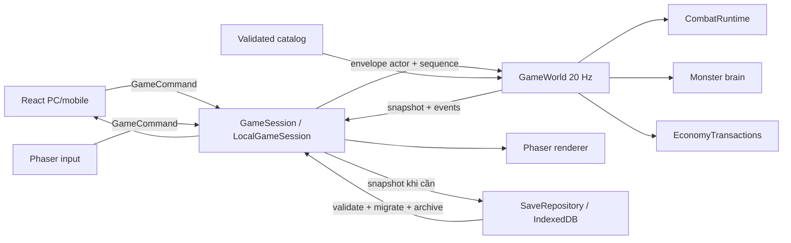

> Baseline v0.2. Thay đổi v0.3 và trạng thái hiện tại: [IMPLEMENTATION_STATUS](IMPLEMENTATION_STATUS.md), [rendering](architecture/rendering.md), [world streaming](architecture/world-streaming.md), [full-release](roadmap/full-release.md).

# Kiến trúc hệ thống v0.2

Nguồn yêu cầu đầy đủ: [MASTER_GAME_DESIGN.md](MASTER_GAME_DESIGN.md). Không thay project hoặc bỏ abstraction đang hoạt động.

`game-core` và `game-protocol` không nhập React, Phaser hoặc IndexedDB. Core typecheck riêng với ES2022/Node không có DOM; CI tests chạy trực tiếp trong Node. Zod command validator nằm trong protocol, kiểm tra envelope ở runtime trước khi xử lý. Giữ RNG có seed, tọa độ world, fixed tick 50 ms và dữ liệu serializable. Sắp xếp/tie-break dùng thứ tự chuỗi ổn định thay locale của máy authority; có replay regression cho khác biệt collation.

`GameSnapshot` v2 chứa world clock, resource cooldown, projectile, telegraph, entity/status/cast/AI và RPG data. Để tương thích UI local, RPG của người đang điều khiển vẫn ở root; `actors` chỉ chứa RPG data của các player khác. `progress(actor)` là điểm lấy dữ liệu chủ sở hữu cho combat reward, quest, đồ, nghề và kỹ năng. `addPlayer` kiểm tra ID trùng. Đây là bước chuẩn bị đa actor; chưa phải server vận hành.

`CombatRuntime` là pipeline duy nhất cho đạn, damage và effects. `EconomyTransactions` kiểm tra/dựng draft/commit; không viết công thức nâng đồ trong UI. AI sử dụng combat runtime. Renderer chỉ chọn frame, project tọa độ, depth, camera và VFX từ kết quả core; trạng thái hình ảnh không quyết định damage.

Local session setInterval 20 Hz; dispose dừng timer/listener. Chưa đưa vào Worker, chưa tích lũy/bù ticks khi tab bị throttle. Snapshot đầy đủ được clone mỗi publish; cần delta/interest management trước thế giới lớn. Tạm dừng chặn tick local; authority server tạo `GameWorld(...,{allowPause:false})`.

Atlas canvas tạo theo loại vũ khí; map terrain texture được thay khi chuyển khu vực. Renderer xóa view của entity đã dọn, chỉ hiển thị map của player local. World giữ dữ liệu map đã thăm, AI chỉ cập nhật map có player. Các map vắng người giữ timer theo tick và xử lý respawn khi được kích hoạt lại.

Đường dẫn chính: `packages/game-core/src/{combat,ai,economy,engine}`, `packages/game-content/src`, `packages/game-protocol/src`, `packages/game-storage/src/migrations`, `apps/web/src/game/{animations,renderers,scenes}`, `apps/web/src/ui`.
