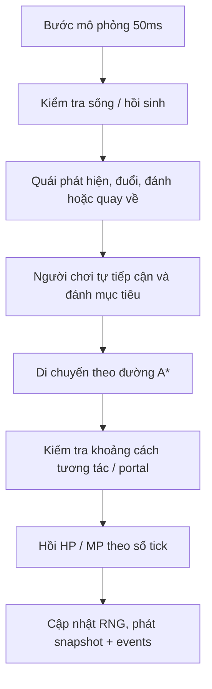

> Tài liệu lịch sử v0.1. Trạng thái và thiết kế hiện tại: [IMPLEMENTATION_STATUS](../IMPLEMENTATION_STATUS.md), [SYSTEM_ARCHITECTURE](../SYSTEM_ARCHITECTURE.md), [COMBAT_DESIGN](../COMBAT_DESIGN.md), [ROADMAP](../ROADMAP.md). Các mô tả thiếu tính năng bên dưới phản ánh baseline trước nâng cấp.

# Shared simulation core

`packages/game-core/src/engine/world.ts` chứa GameWorld, state nối tiếp được và các hệ thống theo tick. Các quy tắc chỉ dựa vào state, content, command và SeededRandom. Không dùng thời gian hệ thống hoặc RNG toàn cục để quyết định gameplay.

- `world/navigation.ts`: phép chiếu, A*, walkability, line-of-sight.
- `combat/formulas.ts`: EXP, chỉ số dẫn xuất, tương khắc và sát thương.
- `inventory/items.ts`: stack, capacity, cấp instance ID và thêm vật phẩm nguyên tử.
- `engine/random.ts`: xorshift32, state có thể lưu và khôi phục.

State có dictionary entity, kind/ownership và mapId, không giả định toàn thế giới chỉ có một entity player. Test tạo thêm player trong cùng instance chứng minh AI chọn mục tiêu hợp lệ. Hiện progression, túi đồ và quest của local character được lưu ở cấp session; trước multiplayer phải chuyển các thành phần này sang per-player record. Đây là công việc mở rộng có chủ ý, không phải cam kết chỉ thay transport là thành MMORPG.

Snapshot được sao chép qua `structuredClone`; không đưa state tham chiếu của world cho UI. Event ID chỉ dùng trong một phiên, cần global/session identifier khi nối mạng. Command sequence được kiểm tra theo actor để loại bỏ replay trùng trong một phiên.
