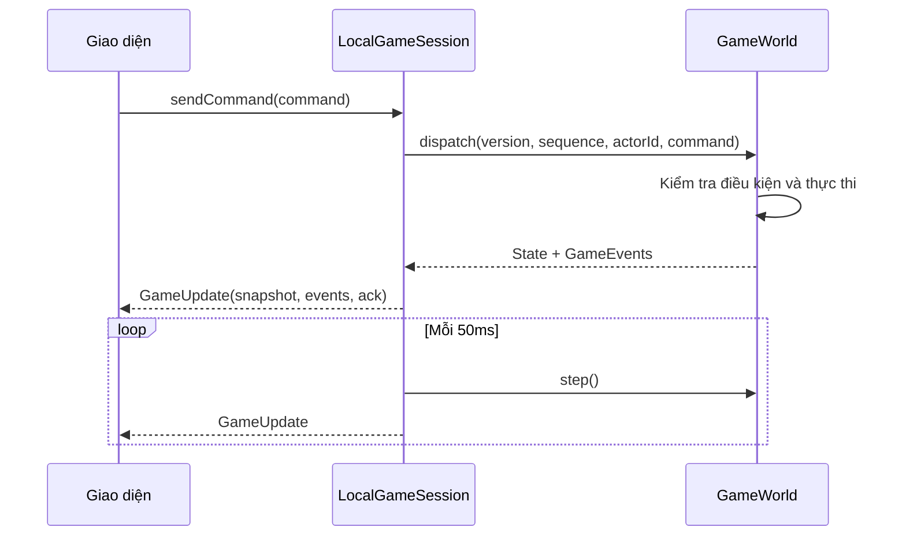

> Tài liệu lịch sử v0.1. Trạng thái và thiết kế hiện tại: [IMPLEMENTATION_STATUS](../IMPLEMENTATION_STATUS.md), [SYSTEM_ARCHITECTURE](../SYSTEM_ARCHITECTURE.md), [COMBAT_DESIGN](../COMBAT_DESIGN.md), [ROADMAP](../ROADMAP.md). Các mô tả thiếu tính năng bên dưới phản ánh baseline trước nâng cấp.

# GameSession

Interface nằm ở game-protocol. Renderer và HUD chỉ dùng `start`, `sendCommand`, `subscribe`, `getSnapshot`, `dispose`. LocalGameSession là implementation hiện tại, được tạo ở composition root `apps/web/src/app/App.tsx`.

`dispose` hủy timer và subscription. Test dùng fake timers kiểm tra 20 bước / giây, quyền sở hữu snapshot, unsubscribe và dispose. Session không phụ thuộc Phaser/React. Browser làm chậm timer tab nền sẽ làm chậm thời gian game, không tự cấp EXP hoặc loot cho thời gian offline.

RemoteGameSession chưa triển khai. Adapter đó sẽ gửi typed envelope qua transport và phát update nhận từ server; không chạy sát thương hoặc nhận client snapshot làm authoritative state. Thay implementation tại composition root, giữ renderer và UI.
