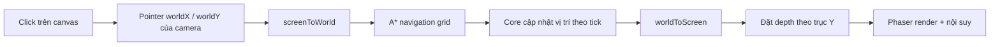
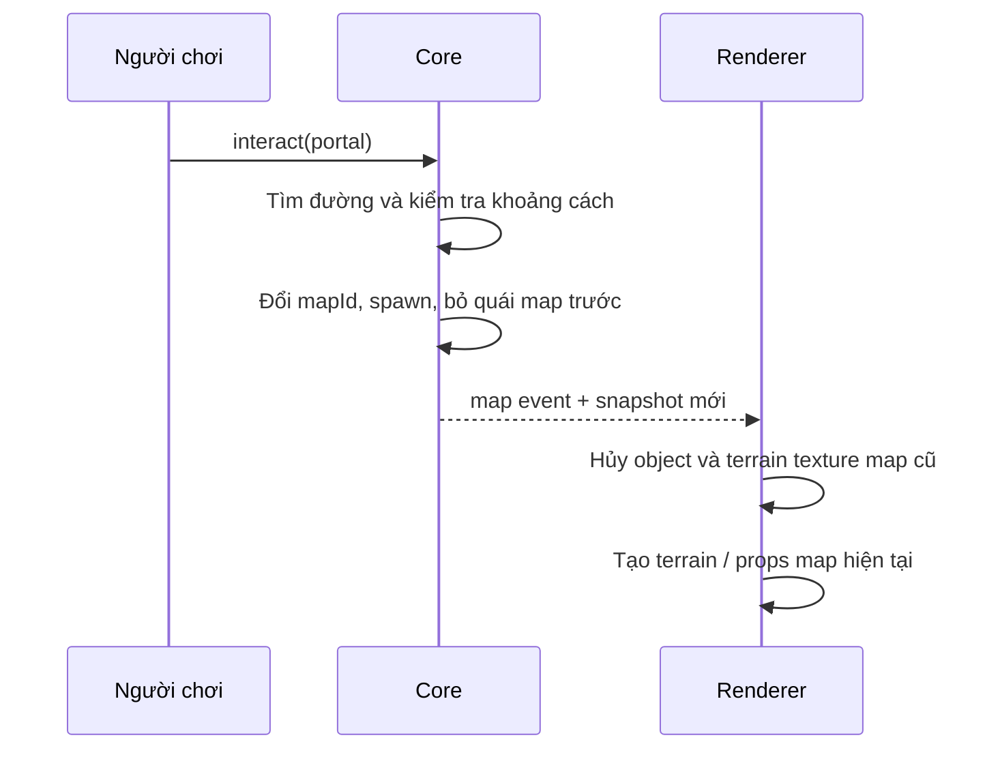

> Tài liệu lịch sử v0.1. Trạng thái và thiết kế hiện tại: [IMPLEMENTATION_STATUS](../IMPLEMENTATION_STATUS.md), [SYSTEM_ARCHITECTURE](../SYSTEM_ARCHITECTURE.md), [COMBAT_DESIGN](../COMBAT_DESIGN.md), [ROADMAP](../ROADMAP.md). Các mô tả thiếu tính năng bên dưới phản ánh baseline trước nâng cấp.

# Bản đồ isometric

Tọa độ simulation tính theo ô vuông, có phần thập phân để di chuyển. Với tile 96×48px: `screenX = (x-y)*48`, `screenY = (x+y)*24`; nghịch đảo: `x = screenX/96 + screenY/48`, `y = screenY/48 - screenX/96`. Save chỉ chứa tọa độ world.

A* dùng tám hướng, không cắt chéo góc vật cản, giới hạn 1100 node cho người chơi và thấp hơn cho AI. Đích không walkable bị từ chối. Kiếm khí dùng kiểm tra line-of-sight với mẫu trên đoạn thẳng. Cần raycast/swept collision nếu bổ sung projectile bay theo tick.

Nội dung map hiện là typed data thay vì Tiled TMJ; adapter Tiled là roadmap. Terrain được tạo khi cần, texture dùng lại trong map; các texture props/sprites dùng chung. Camera có bounds hình chữ nhật, follow và zoom theo viewport. Y-sort xử lý cây/nhà che nhân vật theo vị trí chân.
