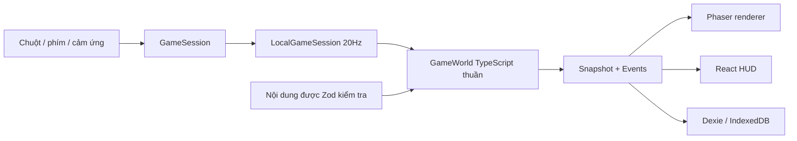

> Tài liệu lịch sử v0.1. Trạng thái và thiết kế hiện tại: [IMPLEMENTATION_STATUS](../IMPLEMENTATION_STATUS.md), [SYSTEM_ARCHITECTURE](../SYSTEM_ARCHITECTURE.md), [COMBAT_DESIGN](../COMBAT_DESIGN.md), [ROADMAP](../ROADMAP.md). Các mô tả thiếu tính năng bên dưới phản ánh baseline trước nâng cấp.

# Kiến trúc Kiếm Hiệp Web

Dự án mới, không có mã cũ. Quyết định: pnpm workspace, React/Vite cho giao diện, Phaser 3 cho render, TypeScript strict cho toàn bộ mã. Không triển khai server ở phiên bản offline. Tài nguyên SVG/canvas do dự án tự tạo, không lấy đồ họa từ game thương mại.

Core không import DOM, React, Phaser, IndexedDB. Session cung cấp snapshot sao chép để ngăn UI thay đổi state. Renderer chỉ biết hợp đồng GameSession. Tọa độ world được lưu theo tile, phép chiếu isometric chỉ nằm ở hàm chuyển đổi/render. RNG xorshift32 được lưu cùng state. Tick 50ms; mọi cooldown, hồi sinh và AI dùng tick. Mỗi callback chạy một bước 50ms; khi trình duyệt giảm tần suất tab ẩn, mô phỏng chậm lại và không cấp thưởng từ thời gian thực đã trôi qua.

Phạm vi phiên bản đầu: một vertical slice có ba bản đồ nhỏ, NPC, nhiệm vụ săn quái và boss, hành trang, shop, nhiều nhân vật, import/export và PWA. Các loại kỹ năng nâng cao, toàn bộ mười môn phái, multiplayer, guild và chế tạo thuộc roadmap, không được coi là đã triển khai.
