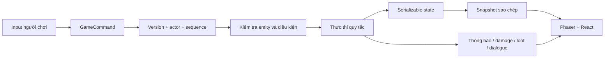
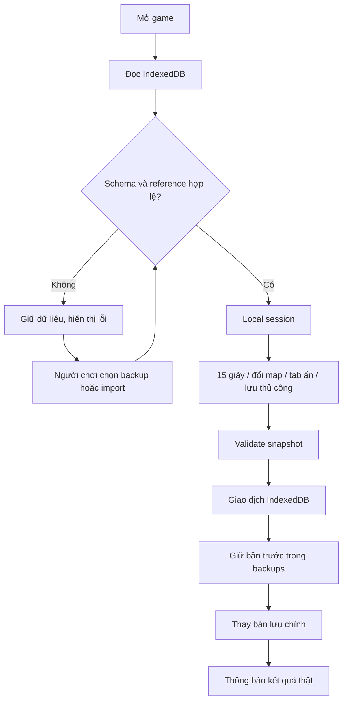

> Tài liệu lịch sử v0.1. Trạng thái và thiết kế hiện tại: [IMPLEMENTATION_STATUS](../IMPLEMENTATION_STATUS.md), [SYSTEM_ARCHITECTURE](../SYSTEM_ARCHITECTURE.md), [COMBAT_DESIGN](../COMBAT_DESIGN.md), [ROADMAP](../ROADMAP.md). Các mô tả thiếu tính năng bên dưới phản ánh baseline trước nâng cấp.

# Command, event và lưu trữ

HP/MP, cấp độ, vị trí, bạc và vật phẩm không bị UI ghi trực tiếp. React chỉ giữ trạng thái panel, tab, thông báo, file import đang chờ xác nhận và bản sao snapshot. Audio/VFX phản ứng event và không gây damage.

Một backup gần nhất cho mỗi character; không phải lịch sử vô hạn. Schema hiện tại là v1; chưa có format v0/v2 để chuyển đổi. Phiên bản không hỗ trợ sẽ bị từ chối, không tự ép kiểu. Khi phát hành schema mới, thêm migration và kiểm thử trước khi mở đường ghi phiên bản mới. Import kiểm tra trước, cần bấm xác nhận ghi đè, sau đó giữ bản trước trong cùng giao dịch.
