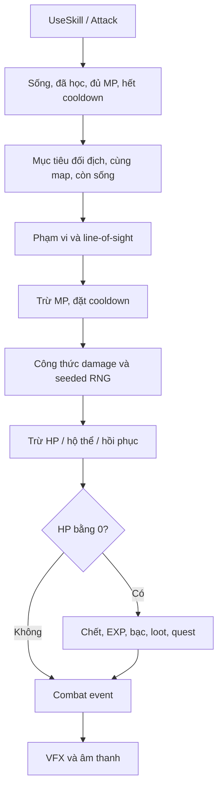

> Tài liệu lịch sử v0.1. Trạng thái và thiết kế hiện tại: [IMPLEMENTATION_STATUS](../IMPLEMENTATION_STATUS.md), [SYSTEM_ARCHITECTURE](../SYSTEM_ARCHITECTURE.md), [COMBAT_DESIGN](../COMBAT_DESIGN.md), [ROADMAP](../ROADMAP.md). Các mô tả thiếu tính năng bên dưới phản ánh baseline trước nâng cấp.

# Chiến đấu

Năm kỹ năng: đánh đơn cận chiến, kiếm khí hitscan, vòng kiếm diện rộng, hồi phục và hộ thể 6 giây. Kỹ năng cuối học được từ cấp 2, dùng điểm võ học khi tăng cấp. Đây là bộ kỹ năng thử nghiệm dùng chung cho ba môn phái, không tái tạo công thức game thương mại.

Sát thương cơ sở = `max(1, round((attack * power - defense * 0.55) * elementalModifier * criticalMultiplier))`. Né tránh 4%, bạo kích 12%, hệ số bạo kích 1.65. Khắc hệ +20%, bị khắc -15%. Bảng tương sinh có trong content rules nhưng chưa dùng làm buff chiến đấu. Hộ thể giảm một nửa damage. Hệ thống hiện không có accuracy/evasion tùy chỉ số, DOT, cone, root hoặc projectile bay có va chạm.

Quái dò tìm player, A* đuổi theo, đánh khi vào tầm, về spawn nếu quá xa, hồi sinh theo tick. Boss tăng damage khi dưới 50% HP. Player chết tự hồi sinh sau 5 giây hoặc bấm nút. Nhật ký thông báo reward; damage/skill event vẫn được chuyển tới renderer, có thể truy xuất trong test để debug.
