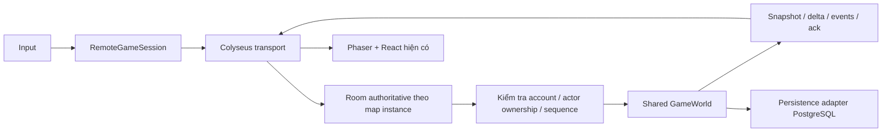

> Tài liệu lịch sử v0.1. Trạng thái và thiết kế hiện tại: [IMPLEMENTATION_STATUS](../IMPLEMENTATION_STATUS.md), [SYSTEM_ARCHITECTURE](../SYSTEM_ARCHITECTURE.md), [COMBAT_DESIGN](../COMBAT_DESIGN.md), [ROADMAP](../ROADMAP.md). Các mô tả thiếu tính năng bên dưới phản ánh baseline trước nâng cấp.

# Kiến trúc online dự kiến

Chưa có server, WebSocket, tài khoản, database online hoặc mô phỏng kết nối giả. `apps/server/README.md` là điểm bắt đầu về sau. Contract không dùng Colyseus Schema; server adapter sẽ chuyển đổi dữ liệu core sang transport format.

Server sở hữu entity và quyết định movement, damage, loot, EXP, quest, gold và item transactions. Không tin actorId từ client: room phải lấy actor từ session đã xác thực. Không nhận client snapshot rồi ghi nguyên trạng. Save offline chỉ là dữ liệu do người dùng quản lý, không mặc định tin cậy khi lên server.

Chia per-player progression/inventory/quests khỏi local snapshot cấp session, sau đó dùng MapInstance registry nhiều room. Entity ID nên gồm instance/session namespace. Event ID cần duy nhất trong phạm vi kết nối. Snapshot chứa tick và acknowledgedSequence làm điểm xuất phát cho interpolation/reconciliation; chưa hiện thực prediction khi chưa có server để kiểm chứng.
